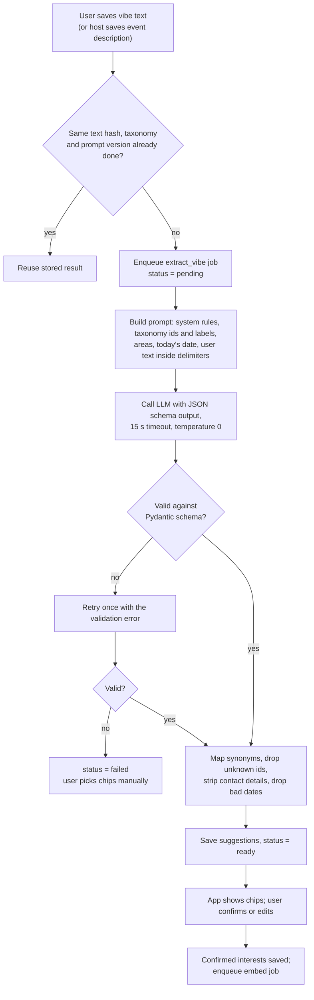

# Vibers Club — Vibe Intelligence and Matching Design

- **Status:** Draft v0.1, for review
- **Last updated:** 2026-10-25
- **Source of truth for:** the intent schema, extraction pipeline, ranking rules and evaluation. The taxonomy itself lives in `data/seed/taxonomy.yaml` once it exists; section 2 is its first draft.

**Summary.** AI does one job: it turns what people write into taxonomy ids, plus a short English summary. Everything else is ordinary code. Who can see whom is decided by SQL rules. The order of results comes from a transparent weighted score, and the explanations come from templates. This keeps the system testable, cheap and explainable. Semantic similarity is one signal in the score, never a gate.

## 1. Principles

1. **Rules decide eligibility, scores decide order.** The model never decides who sees whom.
2. **The user has the last word.** Extracted interests are suggestions; only confirmed interests are used for matching.
3. **The canonical form is language-neutral.** Taxonomy ids and an English canonical summary are what get compared, so Hindi, Hinglish, Farsi and English vibes meet in the same space.
4. **Start with rules, add semantics when we can measure them.** Milestone M4 ships rules-only ranking; M10 adds embeddings once the evaluation set exists.
5. **Every output is logged and versioned** (taxonomy version, prompt version, model), so we can reprocess and compare.

## 2. Initial canonical interest taxonomy (draft v1)

10 categories, 62 interests. Ids are stable; labels can change. Places such as Solang or Kasol are **areas or places**, not interests.

| Category | Interests (id) |
| --- | --- |
| Nature and trekking (`nature`) | `day_hikes`, `multi_day_treks`, `waterfalls`, `forest_walks`, `snow_and_glaciers`, `camping`, `stargazing`, `sunrise_and_sunset`, `river_side_chill` |
| Local culture (`culture`) | `village_life`, `temples_and_heritage`, `monasteries`, `local_festivals`, `homestay_living`, `orchards_and_farms`, `local_crafts`, `meeting_locals`, `slow_travel` |
| Food and cafés (`food`) | `cafe_hopping`, `himachali_food`, `street_food`, `bakeries_and_desserts`, `vegetarian_and_vegan`, `cooking_together`, `coffee_culture` |
| Nightlife and social (`social`) | `clubbing`, `bonfire_nights`, `live_music`, `open_mic`, `hostel_socials`, `board_and_card_games`, `pub_evenings` |
| Adventure (`adventure`) | `paragliding`, `river_rafting`, `skiing_and_snowboarding`, `mountain_biking`, `rock_climbing`, `motorbike_road_trips`, `off_road_drives` |
| Wellness (`wellness`) | `yoga`, `meditation`, `hot_springs`, `digital_detox`, `spiritual_retreats` |
| Work and travel (`work`) | `workation`, `coworking`, `nomad_meetups`, `reliable_wifi` |
| Creative (`creative`) | `photography`, `music_jamming`, `art_and_sketching`, `writing_and_journaling`, `content_creation` |
| Shopping and markets (`markets`) | `local_markets`, `souvenirs_and_woollens`, `flea_and_thrift` |
| Ways of travelling (`style`) | `solo_travel`, `budget_backpacking`, `luxury_stays`, `pet_friendly`, `family_friendly`, `accessible_travel` |

The non-technical team should review this list with real Manali travellers before M2. Adding an interest is cheap; renaming an id is not.

**Intents** (what the Viber is looking for), fixed list:
`travel_companion`, `activity_buddy`, `meet_locals`, `local_recommendations`, `join_events`, `host_events`, `workation_buddies`, `just_exploring`.

**Social preference:** `one_on_one`, `small_group`, `big_group`, `no_preference`. **Pace:** `slow`, `balanced`, `packed`.

## 3. Structured intent schema

The model must return exactly this shape. Pydantic validates it; anything else is rejected.

```python
class VibeExtraction(BaseModel):
    model_config = ConfigDict(extra="forbid")

    schema_version: Literal["1"]
    language: str                       # ISO 639-1 code the user wrote in, e.g. "en", "hi", "fa"
    interest_ids: list[str]             # 0 to 10 ids, each must exist in the active taxonomy
    intents: list[Intent]               # 0 to 3 values from the intent list
    area_id: str | None                 # must exist in areas, or null
    travel_status: Literal["planning", "here_now", "local"] | None
    date_hint_start: date | None        # only if the text states dates explicitly
    date_hint_end: date | None
    social_preference: SocialPreference | None
    pace: Pace | None
    canonical_summary: str              # English, 1 to 2 sentences, at most 300 characters, no names or contact details
    display_hashtags: list[str]         # 0 to 5, lower case, letters, digits and underscores only, at most 30 chars each
    confidence: float                   # 0 to 1, the model's own estimate
```

Validation after parsing:

- Unknown `interest_ids` are mapped through `interest_synonyms`; anything still unknown is dropped and counted.
- Dates in the past, or more than 18 months ahead, are dropped. Dates are suggestions shown to the user, never saved directly into `travel_plans`.
- `canonical_summary` is checked for phone numbers, emails, URLs and @handles with a regex; matches are removed.
- `display_hashtags` are for display only and are never used in matching.

## 4. Extraction and validation pipeline



**Prompt-injection defence.** The user text is placed inside clear delimiters and the system prompt says it is data. More importantly, the model has no tools, cannot see other users' data, and its output can only be taxonomy ids and short strings that we validate. The worst a hostile input can do is produce wrong suggestions for that same user, who then sees and edits them.

**Events** use the same pipeline on title plus description, with the host confirming interests.

## 5. Embedding strategy

- **What is embedded:** a short document built by code, not the raw text:
  `"{canonical_summary} Interests: {confirmed interest labels}. Intents: {intents}. Pace: {pace}."`
  This gives every Viber an English, consistent representation, whatever language they wrote in. It also means a confirmed-interest edit changes the embedding, so the user stays in control.
- **Entities:** profiles, events, and later places and properties.
- **Model:** a multilingual embedding model from a hosted API, chosen in the same evaluation as the LLM (OPEN_QUESTIONS Q5). The model name is stored per row, so a switch means re-embedding, not migrating.
- **When:** after interests are confirmed, and when the summary or interests change (`source_hash` changes).
- **Storage:** `embeddings` table with an HNSW cosine index. At Manali scale (thousands of rows) exact search would also be fine.

## 6. Candidate retrieval (Viber to Viber)

One SQL query returns eligible candidates; Python then scores them.

**Eligibility filters (all must pass):**

1. Candidate `status = 'active'`, `discoverable = true`, has at least one photo and travel status set.
2. Not the viewer; no block in either direction; no existing connection row other than `declined` older than 30 days.
3. Not passed by the viewer in the last 30 days, unless the candidate's travel plan changed since.
4. Women-only: if the viewer has it on, the candidate must be a woman; if the candidate has it on, the viewer must be a woman.
5. **Time compatibility:**
   - Both `here_now` or `planning`: date windows overlap by at least 1 day. If either has `dates_flexible`, each window is widened by 3 days on both sides for this check.
   - Either is `local`: always time-compatible with a visitor whose window includes today or the next 60 days.
6. Both 18+ (guaranteed by signup).

Candidates are capped at 500 by most recent activity before scoring. The pool in Manali will usually be much smaller.

## 7. Ranking algorithm

Each signal is scaled to 0 to 1. The score is a weighted sum. Weights live in config, so they can change without code changes, and they are versioned for evaluation.

### Viber to Viber

| Signal | Definition | Weight (v1) |
| --- | --- | --- |
| Interest overlap | Sum of IDF weights of shared interests ÷ sum of IDF weights of the union (rare shared interests count more than "cafe_hopping") | 0.35 |
| Date overlap | Overlap days ÷ shorter window length; 1 for local-to-visitor; widened windows score at half | 0.20 |
| Intent compatibility | 1 if intents overlap, or form a pair (`meet_locals` with a `local`, `host_events` with `join_events`); 0.5 if either is `just_exploring`; else 0 | 0.15 |
| Location | 1 same area, 0.6 neighbouring area, 0.3 elsewhere in the valley, 0 unknown | 0.10 |
| Semantic similarity | Cosine similarity of embeddings, rescaled; **0 weight until M10** | 0.15 |
| Freshness | 1 if active in the last 24 hours, decaying to 0 at 14 days | 0.05 |

Until M10 the semantic weight is redistributed proportionally to the other signals.

**Diversity.** Within a batch of 20, at most 5 candidates may share the same top interest, so the stack doesn't become 20 paragliders.

### Viber to event

Eligibility: published, upcoming, not hidden, seats or waitlist open, viewer meets `min_age`, host not blocked either way.

| Signal | Weight |
| --- | --- |
| Interest overlap (viewer interests vs event interests) | 0.40 |
| Time fit (event inside the viewer's window, or within 7 days for locals) | 0.25 |
| Location (event area vs viewer area) | 0.10 |
| Semantic similarity (viewer embedding vs event embedding, from M10) | 0.15 |
| Host track record (completed events without upheld reports, capped) | 0.05 |
| Social proof (confirmed registrations ÷ capacity) | 0.05 |

### Viber to place and roadmap

Interest overlap 0.6, area 0.2, similarity to saved places 0.2. Roadmaps rank by the share of their places matching the viewer's interests.

## 8. Match explanations

Built from templates, never generated by the LLM, and only from fields the candidate has made visible.

1. Pick the two strongest contributing signals.
2. Fill a template, for example:
   - Shared interests: "You both love **village life** and **forest walks**."
   - Dates: "You're both in Manali **12 to 15 March**." (omitted if the candidate hides dates; then "Your trips overlap.")
   - Intent: "You're both looking for a **travel companion**."
   - Area: "You're both staying around **Old Manali**."
3. Each explanation lists its signal names in the API response, so the app can highlight chips and tests can assert the reason.

## 9. Caching and reprocessing

| Item | Cached where | Invalidated when |
| --- | --- | --- |
| Extraction result | `vibe_extractions`, keyed by text hash, taxonomy version, prompt version | Text changes; taxonomy or prompt version bump triggers `reprocess_taxonomy` |
| Embedding | `embeddings`, keyed by `source_hash` and model | Summary or confirmed interests change; model change re-embeds all in a batch job |
| Discovery batch | `discovery_batches`, 1 hour | Viewer's plan, interests or settings change; viewer blocks someone; any swipe removes that candidate from the batch |
| IDF weights | In memory, recomputed hourly | — |

## 10. Model failure handling

| Failure | Behaviour |
| --- | --- |
| Timeout (15 s) or provider 5xx | Retry with backoff (10 s, 60 s, 5 min), then `failed` |
| Invalid JSON or schema | One retry with the validation error in the prompt, then `failed` |
| Provider outage (more than half of calls failing over 5 minutes) | Circuit breaker: stop calling for 10 minutes, mark new jobs `failed` fast, alert in Sentry |
| Embedding unavailable | Ranking uses rules-only signals; nothing breaks |
| Output quality drop after a model or prompt change | Caught by the offline evaluation, which must pass before the change is deployed |

The user never waits on the model. Manual interest chips are always available.

## 11. The two cases the brief asks about

**Shared interests, incompatible travel dates.** Two Vibers who both love village life, one in Manali 1 to 5 March and the other 20 to 25 March, fail the time filter and never appear in each other's **companion** stack. Showing them would produce connections that can't turn into meetings. Instead:

- If either marked dates as flexible, the widened window can make them eligible, ranked lower, with "Your dates are close" as the explanation.
- They can still see the same events and places that suit their shared interests, during their own dates.
- Phase 2 idea: a separate "Vibers with your taste" list for planners who haven't fixed dates yet. Not in the MVP.

**Compatible intentions, different language.** A Viber writes "मुझे पुराने मनाली में गाँव की ज़िंदगी देखनी है" (Hindi: I want to see village life in Old Manali). Another writes "slow village life, local food, no touristy stuff". Extraction maps both to `village_life` and `slow_travel` with `area_id = old_manali`, and both canonical summaries are English. Interest overlap is high, and the embeddings of the English summaries are close. Neither user's wording or language affects matching directly. The evaluation set must include such pairs (section 12) to prove it.

## 12. Evaluation datasets and metrics

Built by the team in `eval/datasets/` before M3 ships. Labelling needs no coding skills.

| Dataset | Size (v1) | Content | Metrics |
| --- | --- | --- | --- |
| `vibes_labelled.jsonl` | 150 vibes: about 70 English, 30 Hinglish, 20 Hindi, 15 Farsi, 15 other languages | Text plus gold interest ids, intents, area, travel status | Interest precision, recall and F1 (target set after the first run); intent accuracy; area accuracy; schema-valid rate; share of unknown ids dropped |
| `match_pairs.jsonl` | 120 pairs | Two profiles plus a human label: "would want to meet" yes or no; includes cross-language and date-mismatch pairs | AUC of the score; precision at a threshold; share of cross-language "yes" pairs ranked in the top 20% |
| `ranking_sessions.jsonl` | 20 viewers × 30 candidates | Human-ordered top 10 per viewer | NDCG@10 for rules-only versus rules plus semantics |

`python eval/run_eval.py --provider X --model Y` runs any dataset and prints a report. Any change to the model, prompt or weights must be compared with the previous run before merging.

**Online signals after launch:** like rate per card shown, connection acceptance rate, event RSVP rate from recommendations, and "not relevant" taps (a small option on each card).

## 13. Cost and latency monitoring

- Every model call writes an `ai_calls` row: purpose, model, tokens, cost, latency, outcome.
- A weekly query (admin screen in M11) shows calls, cost, p50 and p95 latency, and failure rate by purpose.
- **Budget guard:** a configurable monthly limit. Past 80%, Sentry alerts; past 100%, extraction pauses and users get manual chips only.
- **Expected volume:** one extraction per vibe or event edit, one embedding per confirmed change. Discovery and ranking make no model calls, so browsing costs nothing in AI.
- **Latency targets:** extraction p95 under 10 seconds (it is asynchronous); discovery API p95 under 500 ms.

## 14. Recommended first implementation

1. **M2:** taxonomy and manual chips only, so matching works with zero AI.
2. **M3:** extraction pipeline plus the eval harness; pick the provider by running `vibes_labelled.jsonl` against two or three candidates.
3. **M4:** rules-only ranking with explanations, tested with fixed fixtures (every signal has unit tests with hand-computed expected scores).
4. **M10:** add embeddings, compare NDCG@10 with and without, and turn on the semantic weight only if it helps.
