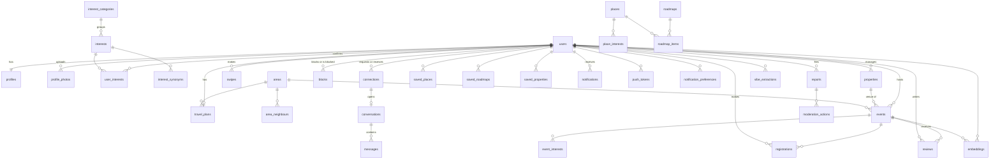

# Vibers Club — Database Design

- **Status:** Draft v0.1, for review
- **Last updated:** 2026-10-25
- **Source of truth:** this document until the first migration exists; after that, the Alembic migrations in `backend/migrations/` are authoritative and this document explains intent.

PostgreSQL 16 with the `pgvector` and `citext` extensions, hosted on Supabase ([ADR-0004](adr/0004-postgres-pgvector-on-supabase.md)). All tables live in the `app` schema. Row-level security is enabled on every table with no policies, so only the backend's database role can read or write ([ADR-0018](adr/0018-lock-down-supabase-data-api.md)).

## Conventions

- Primary keys: `uuid` generated by the database (`gen_random_uuid()`), except lookup tables, which use readable text ids (`old_manali`, `paragliding`).
- Every table has `created_at timestamptz not null default now()`; mutable tables also have `updated_at`.
- Times are stored as `timestamptz` (UTC) and shown in `Asia/Kolkata`.
- Money is stored as integer paise (`price_paise`) with a `currency` column (`INR` only in MVP).
- Enumerations use Postgres `text` plus a `CHECK` constraint, which is easier to migrate than native enum types.
- Soft deletion only where moderation needs it (`hidden_at`); account deletion is real deletion or anonymisation ([SECURITY_AND_PRIVACY.md](SECURITY_AND_PRIVACY.md)).
- JSON columns are used only for audit and raw AI output. Anything the product queries lives in real columns.

## Entity-relationship diagram

## Tables

### Identity and profiles

| Table | Key columns | Constraints and notes |
| --- | --- | --- |
| `users` | `id`, `auth_user_id` (Supabase id), `email citext`, `phone_verified_at`, `date_of_birth`, `role` (`viber`, `moderator`, `admin`), `status` (`active`, `suspended`, `deletion_pending`), `suspended_until`, `deletion_requested_at`, `community_rules_accepted_at` | `auth_user_id` unique; age ≥ 18 checked in the service and by `CHECK (date_of_birth <= (created_at at time zone 'Asia/Kolkata')::date - interval '18 years')` |
| `profiles` | `user_id` (PK and FK), `display_name`, `bio` (≤ 300 chars), `vibe_text` (≤ 1000), `vibe_status` (`none`, `pending`, `ready`, `failed`), `gender` (nullable: `woman`, `man`, `non_binary`, `prefer_not`), `women_only_discovery bool`, `discoverable bool default true`, `show_in_attendee_lists bool default true`, `show_dates bool default true` | `women_only_discovery` allowed only when `gender = 'woman'` (check) |
| `profile_photos` | `id`, `user_id`, `storage_path`, `position` (0 to 5), `status` (`active`, `hidden`) | Unique (`user_id`, `position`); max 6 enforced in service |
| `user_interests` | `user_id`, `interest_id`, `source` (`user`, `ai_confirmed`) | PK (`user_id`, `interest_id`); only confirmed interests are stored here |

### Taxonomy and areas (lookup tables, seeded)

| Table | Key columns | Notes |
| --- | --- | --- |
| `interest_categories` | `id` text, `label`, `position` | |
| `interests` | `id` text, `category_id`, `label`, `description`, `active bool`, `taxonomy_version` | Ids never change meaning; retired interests set `active = false` |
| `interest_synonyms` | `phrase` (lower case), `interest_id`, `language` | Deterministic mapping for model output and search |
| `areas` | `id` text, `label`, `kind` (`manali_area`, `valley`, `elsewhere`), `lat`, `lng`, `position` | Seed list in ADR-0006 |
| `area_neighbours` | `area_id`, `neighbour_id`, `distance_km` | Symmetric; used in location scoring |

### Travel plans

| Table | Key columns | Constraints |
| --- | --- | --- |
| `travel_plans` | `user_id` (PK, one active plan), `status` (`planning`, `here_now`, `local`), `area_id`, `start_date`, `end_date`, `dates_flexible bool`, `intents text[]` (values from the intent list in AI_MATCHING_DESIGN), `pace` (`slow`, `balanced`, `packed`, nullable), `budget` (`budget`, `mid`, `premium`, nullable) | `end_date >= start_date`; dates required unless `status = 'local'`; `intents` checked against the allowed list |

`intents` is a short array of fixed values queried with `&&` (overlap), so an array is acceptable here.

### Vibe intelligence

| Table | Key columns | Notes |
| --- | --- | --- |
| `vibe_extractions` | `id`, `entity_type` (`profile`, `event`), `entity_id`, `input_hash`, `taxonomy_version`, `prompt_version`, `status` (`pending`, `ready`, `failed`), `suggested_interest_ids text[]`, `suggested_area_id`, `suggested_intents text[]`, `date_hint_start`, `date_hint_end`, `canonical_summary` (English, ≤ 300 chars), `display_hashtags text[]`, `confidence numeric`, `raw_output jsonb`, `error` | Unique (`entity_type`, `entity_id`, `input_hash`, `taxonomy_version`, `prompt_version`) makes the job idempotent. Suggestions are not used for matching until the user or host confirms them |
| `embeddings` | `id`, `entity_type` (`profile`, `event`, `place`, `property`), `entity_id`, `model`, `source_hash`, `vector vector(N)` | Unique (`entity_type`, `entity_id`, `model`). `N` is fixed once the embedding model is chosen. HNSW index on `vector` with cosine distance |
| `ai_calls` | `id`, `purpose`, `provider`, `model`, `input_tokens`, `output_tokens`, `cost_usd_micros`, `latency_ms`, `outcome` (`ok`, `invalid_output`, `timeout`, `error`), `job_id` | No user text stored here; used for cost and latency dashboards |

### Discovery, connections, messaging, safety

| Table | Key columns | Constraints |
| --- | --- | --- |
| `swipes` | `actor_id`, `target_id`, `action` (`like`, `pass`, `save`), `created_at` | PK (`actor_id`, `target_id`); a new swipe replaces the old one; `actor_id <> target_id` |
| `discovery_batches` | `user_id`, `computed_at`, `candidate_ids uuid[]`, `scores jsonb`, `inputs_hash` | Cache only; safe to delete at any time |
| `connections` | `id`, `requester_id`, `addressee_id`, `user_low`, `user_high` (the two ids sorted), `status` (`pending`, `accepted`, `declined`, `removed`), `note` (≤ 200), `responded_at` | Unique (`user_low`, `user_high`) so a pair has one row; `requester_id <> addressee_id` |
| `conversations` | `id`, `connection_id` (unique) | Created on accept |
| `messages` | `id` (bigint identity, gives a simple "after" cursor), `conversation_id`, `sender_id`, `body` (1 to 2000 chars), `created_at`, `hidden_at` | Index (`conversation_id`, `id`) |
| `conversation_reads` | `conversation_id`, `user_id`, `last_read_message_id` | PK (`conversation_id`, `user_id`) |
| `blocks` | `blocker_id`, `blocked_id` | PK (`blocker_id`, `blocked_id`); creating a block sets any connection to `removed` in the same transaction |
| `rate_limit_counters` | `user_id`, `action`, `window_start`, `count` | PK (`user_id`, `action`, `window_start`); daily limits for connection requests, reports, events |

### Events and properties

| Table | Key columns | Constraints |
| --- | --- | --- |
| `properties` | `id`, `manager_user_id`, `name`, `type` (`hotel`, `hostel`, `homestay`, `cottage`, `cafe`, `activity_provider`, `other`), `area_id`, `address`, `lat`, `lng`, `description`, `amenities text[]` (fixed list), `website_url`, `booking_url`, `status` (`active`, `hidden`), `verified_at` | A property is a listing, not an account ([ADR-0015](adr/0015-everyone-is-a-viber.md)) |
| `property_photos` | `id`, `property_id`, `storage_path`, `position` | Max 10 |
| `events` | `id`, `host_user_id`, `property_id` (nullable), `title` (≤ 100), `description` (≤ 2000), `category` (fixed list), `start_at`, `end_at`, `area_id`, `meeting_point_name`, `lat`, `lng`, `capacity` (1 to 500), `pricing_type` (`free`, `paid`, default `free`), `price_paise`, `currency`, `payment_instructions` (≤ 500), `min_age` (≥ 18), `status` (`published`, `cancelled`, `completed`), `hidden_at`, `cancelled_reason` | `end_at > start_at`; `price_paise > 0` when paid, null when free; if `property_id` is set, the property's `manager_user_id` must equal `host_user_id` (checked in service and by trigger) |
| `event_interests` | `event_id`, `interest_id`, `source` (`host`, `ai_confirmed`) | PK (`event_id`, `interest_id`) |
| `event_photos` | `id`, `event_id`, `storage_path` | Max 1 cover in MVP |
| `registrations` | `id`, `event_id`, `user_id`, `status` (`confirmed`, `waitlisted`, `cancelled`), `payment_status` (`not_required`, `pending`, `paid`), `attendance` (`unknown`, `attended`, `no_show`), `waitlisted_at`, `cancelled_at` | Unique (`event_id`, `user_id`); host cannot register for own event |

**Capacity rule.** Registration and cancellation lock the event row (`SELECT ... FOR UPDATE`) and count `confirmed` rows inside the same transaction. An integration test runs 20 simultaneous registrations for a capacity of 5 and asserts exactly 5 are confirmed.

### Places, roadmaps, saves

| Table | Key columns | Notes |
| --- | --- | --- |
| `places` | `id`, `name`, `category` (`cafe`, `viewpoint`, `trail`, `temple`, `market`, `waterfall`, `activity`, `other`), `area_id`, `lat`, `lng`, `description`, `source` (`curated`, `osm`), `verified_at`, `status` | Only curated data; no opening hours or prices in MVP, so nothing can go stale silently |
| `place_interests` | `place_id`, `interest_id` | |
| `roadmaps` | `id`, `slug`, `title`, `summary`, `days`, `pace`, `status` | Curated in `data/seed/roadmaps.yaml` |
| `roadmap_items` | `roadmap_id`, `day`, `position`, `place_id`, `note` | PK (`roadmap_id`, `day`, `position`) |
| `saved_places`, `saved_roadmaps`, `saved_properties` | `user_id`, `<item>_id`, `created_at` | Separate tables keep real foreign keys |

### Reviews

| Table | Key columns | Constraints |
| --- | --- | --- |
| `reviews` | `id`, `event_id`, `author_id`, `rating` (1 to 5), `text` (≤ 1000), `status` (`visible`, `hidden`) | Unique (`event_id`, `author_id`); service checks a confirmed registration exists and author is not the host |

### Notifications

| Table | Key columns | Notes |
| --- | --- | --- |
| `notifications` | `id`, `user_id`, `type` (fixed list), `actor_id`, `event_id`, `connection_id`, `conversation_id`, `title`, `body`, `read_at`, `push_sent_at` | Typed reference columns instead of a JSON payload |
| `push_tokens` | `user_id`, `expo_token` (unique), `platform`, `last_seen_at` | Tokens that Expo reports as invalid are deleted |
| `notification_preferences` | `user_id`, `type`, `push_enabled` | Missing row means the default for that type |

### Moderation and audit

| Table | Key columns | Notes |
| --- | --- | --- |
| `reports` | `id`, `reporter_id`, `target_type` (`user`, `message`, `event`, `review`, `property`), `target_id`, `reason` (`harassment`, `spam_or_promotion`, `fake_profile`, `unsafe_event`, `inappropriate_content`, `underage`, `other`), `note` (≤ 500), `status` (`open`, `actioned`, `dismissed`), `resolved_at` | `target_type` plus `target_id` is polymorphic; the service validates the target exists |
| `moderation_actions` | `id`, `moderator_id`, `report_id` (nullable), `target_type`, `target_id`, `action` (`dismiss`, `hide`, `unhide`, `warn`, `suspend`, `unsuspend`), `reason`, `created_at` | Append-only: the backend role has no `UPDATE` or `DELETE` on this table |

## Key indexes

- `travel_plans (status, start_date, end_date)` and `travel_plans (area_id)` for discovery filters.
- `events (status, start_at)` partial on `status = 'published' and hidden_at is null`.
- `registrations (event_id, status)`.
- `embeddings` HNSW on `vector` (cosine).
- `blocks (blocked_id)` for reverse lookups.
- `notifications (user_id, created_at desc)`.

## Migration rules

- Every change is an Alembic migration, reviewed in a pull request. Never change the schema in the Supabase dashboard.
- Migrations must be backwards-compatible with the running app version: add columns as nullable first, backfill, then add constraints in a later migration.
- Seed data (taxonomy, areas, places, roadmaps) is loaded by an idempotent command (`python -m app.seed`), not by migrations.
