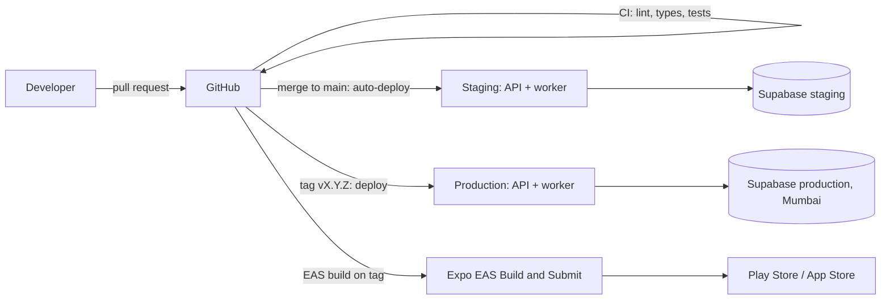

# Vibers Club — Environments and Deployment Plan

- **Status:** Plan only (Phase 2). The step-by-step guide is written in Phase 6, once there is something to deploy.
- **Last updated:** 2026-10-25

## 1. Environments

| Environment | Purpose | Backend | Database and auth | App build |
| --- | --- | --- | --- | --- |
| Local | Development and tests | `uvicorn` and worker on the developer's machine | Docker Postgres with pgvector for tests; a shared **dev** Supabase project for auth | Expo Go or a development build on a phone |
| Staging | Team testing, demos, the pitch | API and worker on the host's staging service | Separate Supabase project, demo seed data | EAS "preview" build (internal distribution) |
| Production | Real users | API and worker, production service | Separate Supabase project, Mumbai region, paid tier before launch | EAS "production" build in Play Store and App Store |

Staging and production never share keys, buckets or databases.

## 2. Deployment architecture

- **API host:** a platform service such as Render, Railway or Fly.io, running two processes from one Docker image: `web` (`uvicorn`) and `worker` (`procrastinate worker`). Choose the region closest to Mumbai the provider offers. Chosen: **Render** (approved with the blueprint); Railway or Fly.io remain fallbacks.
- **Migrations:** run as a release step before the new web process starts (`alembic upgrade head`). Migrations are backwards-compatible (DATABASE_DESIGN), so the old version keeps working during deploy.
- **App updates:** JavaScript-only fixes ship as EAS Update (over the air) to the matching build channel; native changes need a new store build.
- **Rollback:** API: redeploy the previous image (the host keeps previous deploys). Database: forward-fix migrations; point-in-time restore only for disasters. App: republish the previous EAS Update.

## 3. Configuration plan

These are the planned variable names. They do not exist yet; values come from each service's dashboard when the accounts are created. Real values never go in the repository; `.env.example` holds names only.

### Backend (API and worker)

| Variable | Purpose | Secret? |
| --- | --- | --- |
| `APP_ENV` | `local`, `staging` or `production` | No |
| `DATABASE_URL` | Postgres connection string for the backend role (pooled, via Supabase's connection pooler) | Yes |
| `SUPABASE_URL` | Project URL (JWKS, Storage, Auth admin) | No |
| `SUPABASE_JWT_AUDIENCE` | Expected `aud` claim | No |
| `SUPABASE_SERVICE_ROLE_KEY` | Storage signed URLs and Auth admin calls (phone status, user deletion) | Yes |
| `STORAGE_BUCKET_PHOTOS` | Private bucket name | No |
| `LLM_PROVIDER`, `LLM_MODEL`, `LLM_API_KEY` | Extraction model | Key: yes |
| `EMBEDDING_PROVIDER`, `EMBEDDING_MODEL`, `EMBEDDING_API_KEY` | Embeddings (from M10) | Key: yes |
| `AI_MONTHLY_BUDGET_USD` | Budget guard | No |
| `EXPO_ACCESS_TOKEN` | Expo Push (enhanced security option) | Yes |
| `SENTRY_DSN` | Error reporting | No (but keep private) |
| `RATE_LIMITS_CONFIG` | Optional override of default limits | No |

### Mobile app (public by nature: anything in the app can be read by users)

| Variable | Purpose |
| --- | --- |
| `EXPO_PUBLIC_API_URL` | Backend base URL |
| `EXPO_PUBLIC_SUPABASE_URL` | Supabase project URL |
| `EXPO_PUBLIC_SUPABASE_ANON_KEY` | Public key, safe only because the Data API is locked down (ADR-0018) |
| `EXPO_PUBLIC_SENTRY_DSN` | App error reporting |
| `EXPO_PUBLIC_POSTHOG_KEY` | Analytics project key |

The app must never contain the service-role key or any AI provider key.

## 4. Accounts the team will need

| Service | Needed by | Cost note |
| --- | --- | --- |
| GitHub (existing) | M0 | Free |
| Supabase (dev, staging; production later) | M1 | Free tier for dev and staging; paid tier for production before pilot |
| Expo (EAS) | M0 | Free tier enough for early builds |
| Google Cloud (OAuth client) and Apple Developer Program | M1 | Apple has an annual fee; Google Play has a one-time fee |
| LLM and embedding provider | M3 | Pay as you go |
| API host | M0 (staging) | Free or low tier initially |
| Sentry, PostHog | M0 / M12 | Free tiers |
| SMTP sender for auth emails | Before pilot | Free tier |
| SMS for phone OTP (via Supabase's provider integration) | M5 | Pay per SMS |

## 5. Operations basics (detailed in Phase 6)

- Backups: Supabase daily backups on paid tier; test a restore into staging before launch.
- Monitoring: Sentry for errors; host metrics for CPU and memory; a daily check of failed jobs and report queue age.
- Health check: `/healthz` used by the host to restart unhealthy instances.
