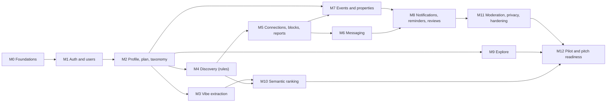

# Vibers Club — Implementation Roadmap

- **Status:** Draft v0.1, for review. No milestone starts until ARPIT approves the blueprint and that milestone.
- **Last updated:** 2026-10-25

Thirteen small milestones, each a working, tested slice. Most are one or two pull requests. A milestone is done only when its definition of done is met and PROGRESS.md is updated.

**Definition of done (applies to every milestone):** code merged to `main`; CI green; the listed tests exist and pass; local verification steps run by someone other than the author; docs updated where behaviour changed; PROGRESS.md updated; no known critical bug left open.

## Order and dependencies

**Can run in parallel** once M2 is merged: M3, M4, M7 (after M5 for block checks) and M9. Non-code tracks can start now (section "Parallel non-code tracks").

---

## M0. Foundations
- **Delivered in three steps:** M0a backend skeleton (done); M0b Next.js website skeleton calling `/healthz` (done); M0c CI workflow and staging deploys.
- **Objective:** an empty but real website and API that build, test and deploy.
- **Prerequisites:** blueprint approved; GitHub repo (exists); Render account (API); Vercel account (website); Sentry project.
- **Affected:** `backend/` skeleton (done in M0a); `backend/app/core/` CORS settings; `apps/web/` (Next.js App Router, TypeScript, Tailwind, five empty sections with mobile bottom navigation, PWA manifest); `.github/workflows/ci.yml`; `.env.example` files.
- **Tasks (M0b):** create the Next.js app with pnpm; Tailwind; layout with bottom navigation on phones and a sidebar on wide screens; a home page that calls `/healthz` and shows "API OK" or a clear error; `NEXT_PUBLIC_API_URL` setting; CORS on the API for the website's origin; web app manifest and icons; Vitest and Playwright set up.
- **Tests:** API: `/healthz`, migration round-trip, CORS allows the configured origin and rejects others. Website: component test for the health status (ok, error, loading); Playwright test at phone size that the home page shows "API OK" against a running API.
- **Local verification:** `docker compose up -d db` → backend running on port 8000 → `pnpm --filter web dev` → open http://localhost:3000 on the laptop and on a phone on the same Wi-Fi (via the laptop's network address); the home page shows "API OK".
- **Acceptance:** CI green on a pull request; staging website loads over HTTPS and shows "API OK" from the staging API.
- **Failure modes:** pgvector missing in the image (use `pgvector/pgvector:pg16`); CORS error in the browser console (origin missing from `CORS_ALLOWED_ORIGINS`); phone can't reach the laptop (firewall, or use a tunnel).

## M1. Sign-in and users
- **Objective:** a person can sign in and gets a `users` row; suspended users are blocked.
- **Prerequisites:** M0; Supabase dev project; Google OAuth client; email service as Supabase's SMTP sender for sign-in codes.
- **Affected:** `app/core/auth.py`, `modules/identity/`, migration for `users` and `profiles`, website `(auth)/` pages, `lib/auth.ts`.
- **Tasks:** JWKS verification with caching; current-user dependency; `POST /me`, `GET /me`; age check; Supabase client in the website with cookie sessions (`@supabase/ssr`); welcome, sign-in, birthday screens; test JWT signer for integration tests.
- **Tests:** token valid, expired, wrong audience, wrong key; under-18 rejected; `POST /me` idempotent; suspended user 403.
- **Local verification:** sign in with Google on the local website; the Profile page shows your name from `GET /me`.
- **Acceptance:** PRD J1 sign-in and 18+ criteria.
- **Failure modes:** redirect URI misconfigured for OAuth; clock skew on token expiry (allow 60 s leeway).

## M2. Profile, travel plan and taxonomy
- **Objective:** a Viber can complete onboarding and edit their profile, with manual interests.
- **Prerequisites:** M1; taxonomy and areas reviewed by the team (parallel track T1).
- **Affected:** `modules/profiles/`, `modules/travel_plans/`, `modules/taxonomy/`, `data/seed/taxonomy.yaml`, `areas.yaml`, seed command, migrations, onboarding and profile screens, photo upload.
- **Tasks:** tables and endpoints from MVP_SPEC F2; seed loader; signed-URL photo upload; Storage bucket private; profile completeness; first visual design pass (colours, type, components).
- **Tests:** plan validation; interest ids must exist; photo registration failures; profile response never includes email or phone.
- **Local verification:** fresh account → onboarding with skips → profile shows plan, interests, photo.
- **Acceptance:** PRD J1 except AI extraction.
- **Failure modes:** large photos on slow networks (resize in the browser before upload); seed loader run twice (must be idempotent).

## M3. Vibe extraction
- **Objective:** free text becomes suggested interests within about 10 seconds, with a fallback.
- **Prerequisites:** M2; LLM provider chosen via the eval harness (parallel track T2 provides `vibes_labelled.jsonl`).
- **Affected:** `modules/vibe_intelligence/`, `app/ai/llm.py`, `app/worker/`, `eval/run_eval.py`, migrations for `vibe_extractions`, `ai_calls`, `interest_synonyms`; vibe composer screen.
- **Tasks:** Procrastinate setup and worker process; `extract_vibe` job; Pydantic schema; synonym mapping; contact-detail stripping; circuit breaker; budget guard; eval harness; deploy worker to staging.
- **Tests:** fake adapter cases (valid, invalid then valid, hostile text, timeout, outage); idempotency; eval run recorded in the PR.
- **Local verification:** run worker; write a Hinglish vibe; see chips; stop the worker and confirm manual chips appear after 15 s.
- **Acceptance:** PRD J1 extraction criteria; eval report attached with agreed minimum scores.
- **Failure modes:** model returns ids outside taxonomy (dropped and counted); cost spike from retries (retry cap plus budget guard).

## M4. Discovery (rules-only ranking)
- **Objective:** a Viber sees eligible, well-ordered Vibers with explanations, and can swipe.
- **Prerequisites:** M2 (M3 not required).
- **Affected:** `modules/discovery/`, `modules/trust_safety/` (blocks table only), migrations for `swipes`, `discovery_batches`, `blocks`; Discover screens.
- **Tasks:** eligibility query; signals and weights in config; IDF weights; diversity rule; explanations; batch cache and invalidation; swipe endpoint with mutual detection; empty state.
- **Tests:** every eligibility filter in both directions; every signal with hand-computed fixtures; explanation uses only visible fields; performance check with 5,000 fake profiles (p95 under 500 ms locally).
- **Local verification:** `python -m app.seed --demo` → sign in as a demo Viber → swipe through, check each explanation matches the profiles.
- **Acceptance:** PRD J2.
- **Failure modes:** empty pool in quiet weeks (empty state links to events); one popular interest dominating (diversity rule).

## M5. Connections, blocks and reports
- **Objective:** Vibers can connect safely, block and report.
- **Prerequisites:** M4; phone verification via Supabase SMS provider configured.
- **Affected:** `modules/connections/`, `modules/trust_safety/`, `modules/identity/` (verification sync), migrations for `connections`, `reports`, `rate_limit_counters`; request, inbox, block and report screens; phone verification screen.
- **Tests:** see MVP_SPEC F5 and F7.
- **Local verification:** two test accounts on two devices: request, accept, block, confirm both disappear from each other's discovery.
- **Acceptance:** PRD J3 (connections, block, report).
- **Failure modes:** SMS not delivered to foreign numbers (known gap, OPEN_QUESTIONS Q2); simultaneous mutual requests.

## M6. Messaging
- **Objective:** connected Vibers can chat.
- **Prerequisites:** M5 (email digests for unread messages arrive in M8; chat works without them).
- **Affected:** `modules/messaging/`, migrations; Chats and Chat screens.
- **Tests:** MVP_SPEC F6.
- **Local verification:** two browsers (or a laptop and a phone) exchange messages; block mid-chat stops sending.
- **Acceptance:** PRD J3 messaging criteria.
- **Failure modes:** battery drain from polling (poll only while chat is open and app is in the foreground).

## M7. Events and properties
- **Objective:** anyone verified can host; anyone can find and register.
- **Prerequisites:** M2, M5 (block checks); M3 optional (interest suggestions).
- **Affected:** `modules/events/`, `modules/places/` (properties), migrations; event and property screens.
- **Tests:** MVP_SPEC F8 and F9, including the concurrency test.
- **Local verification:** create a paid event linked to a property; register from three accounts with capacity 2; third is waitlisted; cancel one; waitlisted moves up.
- **Acceptance:** PRD J4, J5, J5b.
- **Failure modes:** time-zone bugs (store UTC, display Asia/Kolkata, tests with frozen clock); hosts editing capacity below registrations (rejected).

## M8. Notifications, reminders and reviews
- **Objective:** time-sensitive moments reach people; attendees can review.
- **Prerequisites:** M6, M7.
- **Affected:** `modules/notifications/`, `modules/reviews/`, worker jobs `send_email_notification`, `send_unread_digest`, `event_reminder`, `send_feedback_requests`, `promote_waitlist`; notification and review screens.
- **Tests:** MVP_SPEC F11 and F12; each job run twice sends one email.
- **Local verification:** create an event starting in 26 hours with a frozen-clock dev command that fast-forwards jobs; receive reminder and feedback emails (in a local mail catcher) and in-app notifications.
- **Acceptance:** PRD J4 reminders, J6.
- **Failure modes:** duplicate emails (idempotency key); bounces and spam-folder delivery (verified domain with SPF and DKIM).
- **Optional:** web push for browsers that support it, only after email works.

## M9. Explore
- **Objective:** curated places and roadmaps, with saves.
- **Prerequisites:** M2; curated dataset (parallel track T3).
- **Affected:** `modules/places/`, `data/seed/places.csv`, `roadmaps.yaml`; Explore screens.
- **Tests:** MVP_SPEC F10.
- **Local verification:** load seed; filter by Old Manali and `cafe_hopping`; save a roadmap; see it under Saved.
- **Acceptance:** PRD J7.
- **Failure modes:** bad rows in the CSV (loader reports line numbers and refuses partial loads).

## M10. Semantic ranking
- **Objective:** add embeddings to discovery and events only if they measurably help.
- **Prerequisites:** M3, M4; embedding model chosen; `match_pairs.jsonl` and `ranking_sessions.jsonl` (track T2).
- **Affected:** `app/ai/embeddings.py`, `embeddings` table and HNSW index, embed jobs, discovery and events scoring.
- **Tests:** embedding job idempotency; ranking falls back cleanly when vectors are missing; eval comparison report.
- **Local verification:** run eval with semantic weight 0 and 0.15; compare NDCG@10 and cross-language results.
- **Acceptance:** semantic weight turned on only if NDCG@10 improves and no eligibility test changes; decision recorded in an ADR.
- **Failure modes:** vector dimension mismatch after a model change (model stored per row; re-embed job).

## M11. Moderation, privacy and hardening
- **Objective:** the team can run a safe pilot.
- **Prerequisites:** M8.
- **Affected:** `modules/moderation/`, `modules/identity/` (deletion), rate limits, Sentry scrubbing, EXIF stripping, `/mod` screens, privacy settings screens.
- **Tests:** MVP_SPEC F13 and F14; full authorization matrix; deletion job.
- **Local verification:** report a message as user A; moderator hides it and suspends user B; B is signed out of actions; audit row exists.
- **Acceptance:** PRD J8, J9; SECURITY_AND_PRIVACY checklist sections 3 to 8 ticked.
- **Failure modes:** moderators unavailable (alert on report age over 24 hours).

## M12. Pilot and pitch readiness
- **Objective:** a polished, measurable build in testers' hands.
- **Prerequisites:** M9, M10 (or a decision to skip semantics), M11; partner venues (track T4); legal review (track T5) before public launch.
- **Affected:** analytics (`lib/analytics.ts`), demo seed, production website deploy and domain, Playwright journeys, PROGRESS.md.
- **Tasks:** PostHog events for every PRD metric; metrics queries; demo script; production deploy on our own domain; Playwright journeys for J1 to J9; performance pass on a low-end Android phone's browser over 4G (Lighthouse mobile score recorded).
- **Acceptance:** PRD section 9; all journeys J1 to J9 pass on staging with real devices.
- **Failure modes:** slow first load on mountain networks (keep pages light, cache static assets, measure on 4G).

---

## Parallel non-code tracks (can start now)

| Track | Owner (suggested) | Output | Needed by |
| --- | --- | --- | --- |
| T1 Taxonomy and areas review | Non-technical teammate | Reviewed `taxonomy.yaml`, `areas.yaml` | M2 |
| T2 Evaluation datasets | Two teammates labelling | `vibes_labelled.jsonl` (150), `match_pairs.jsonl` (120), `ranking_sessions.jsonl` | M3, M10 |
| T3 Curated places and roadmaps | Teammate who knows Manali | `places.csv` (100 to 200 rows), `roadmaps.yaml` (3 to 5) | M9 |
| T4 Partner venues and concierge test | ARPIT | 5 to 10 committed venues; concierge results (PRD H1, H2) | M12 |
| T5 Legal review | ARPIT with a lawyer | Answers to SECURITY_AND_PRIVACY section 10 | Public launch |
| T6 Visual design | Designer or teammate | Brand, colours, key screens (phone first, then desktop) | M2 |
| T7 Women travellers interviews | Teammate | 5 interviews on women-only discovery (ADR-0013) | M4 |
