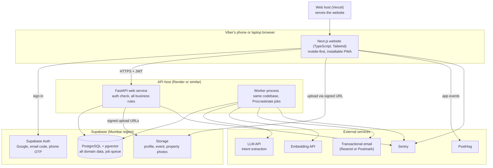
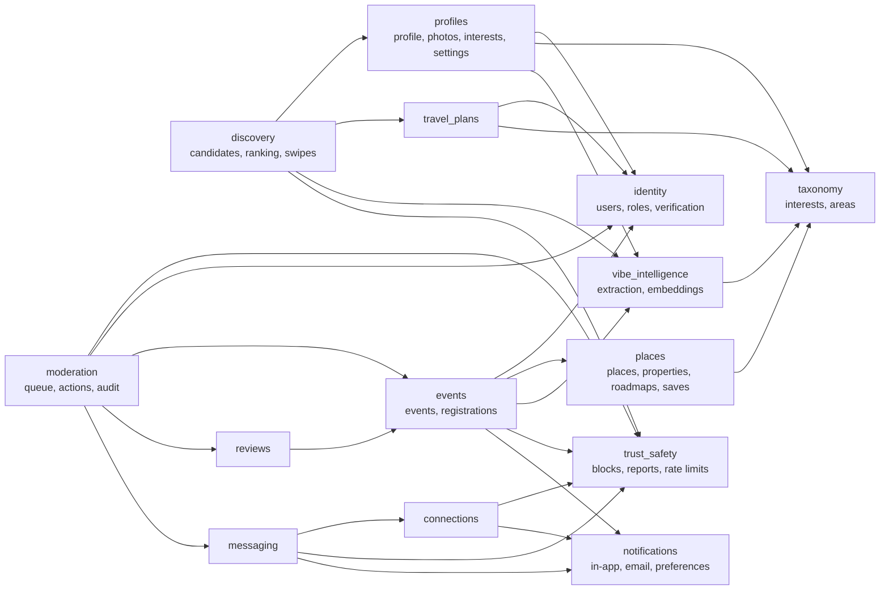
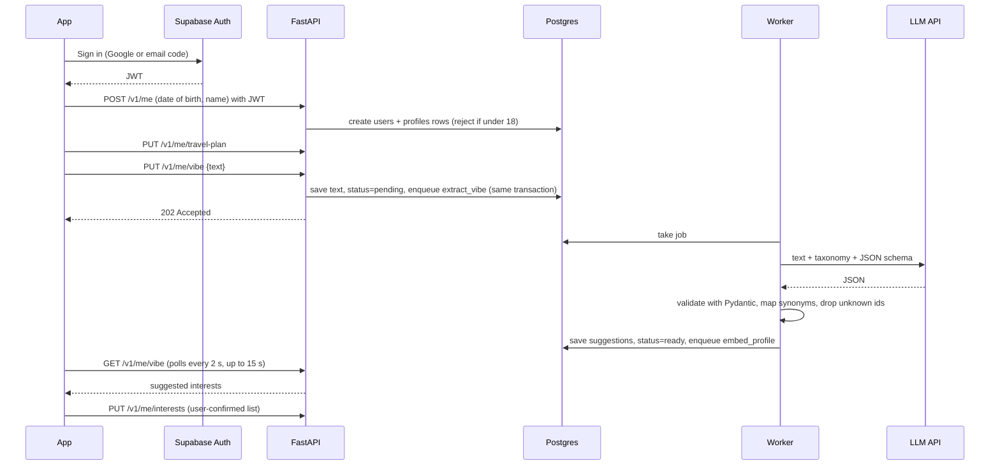

# Vibers Club — System Architecture

- **Status:** Draft v0.1, for review
- **Last updated:** 2026-10-25
- **Source of truth for:** components, module boundaries, data flows, background jobs and repository layout. Requirements live in [PRD.md](PRD.md), decisions in [adr/](adr/), tables in [DATABASE_DESIGN.md](DATABASE_DESIGN.md), endpoints in [API_SPECIFICATION.md](API_SPECIFICATION.md).

The system is one mobile-first Next.js website talking to one FastAPI service ([ADR-0020](adr/0020-mobile-first-website-first.md)). A worker process from the same codebase handles background jobs. Everything is stored in one Postgres database on Supabase, which also provides sign-in and photo storage. Nothing talks to the database except our backend.

---

## 1. Architecture review

I checked the proposed architecture (Phase 0 plus ADR-0001 to ADR-0015) against each capability in the brief.

| Capability | Supported? | How, or what was missing |
| --- | --- | --- |
| Profiles and onboarding | Yes | `profiles` module; progressive onboarding, only travel status mandatory |
| Structured travel intentions | Yes | `travel_plans` table with status, area, date window, flexibility, intents |
| AI interest extraction | Yes | `vibe_intelligence` module plus worker job, schema-validated ([AI_MATCHING_DESIGN.md](AI_MATCHING_DESIGN.md)) |
| Canonical interest normalisation | Yes | Versioned taxonomy file plus synonym table; the LLM may only return taxonomy ids |
| Semantic matching | Yes | pgvector embedding of an English **canonical summary** (so different languages compare fairly) |
| Date and location compatibility | Yes | Hard SQL filters plus scored overlap; named areas with a neighbour table |
| Swipe discovery | Yes | `discovery` module; cached candidate batches |
| Connections and messaging | **Gap fixed** | Supabase Realtime needs the app to talk to the database directly, which conflicts with ADR-0004. Replaced by REST plus polling while a chat is open, with in-app and email notifications ([ADR-0016](adr/0016-chat-over-rest-polling-and-push.md)) |
| Event creation and registration | Yes | `events` module; capacity enforced with a row lock in one transaction |
| Business and accommodation profiles | **Changed** | No business accounts ([ADR-0015](adr/0015-everyone-is-a-viber.md)). Property pages are listings a Viber manages, in the `places` module |
| Personalised roadmaps | Yes, curated only | MVP roadmaps are hand-made and ranked by interests; AI-built roadmaps are phase 2 |
| Experience reviews | Yes | `reviews` module; only confirmed attendees can review |
| Scheduled feedback requests | Yes | Worker job scheduled at event end plus 2 hours |
| Notifications | **Gap fixed** | No delivery channel was named. In-app notifications plus transactional email (web push optional), since mobile browsers limit push ([ADR-0020](adr/0020-mobile-first-website-first.md)) |
| Moderation and reporting | **Gap fixed** | No moderation interface existed. Moderators use role-gated `/mod` pages inside the website ([ADR-0017](adr/0017-moderation-inside-the-app.md)) |
| Privacy and access controls | **Gap fixed** | Supabase exposes tables over its own REST API with the public key. Row-level security must be on with no policies for every table ([ADR-0018](adr/0018-lock-down-supabase-data-api.md)) |
| Product metrics | **Gap fixed** | The PRD metrics had no collection mechanism. Added PostHog (free tier) for app events, and server-side counts from the database ([ADR-0019](adr/0019-product-analytics-with-posthog.md)) |

**Removed as unnecessary for MVP**

- A native mobile app for now (ADR-0020: website first, Expo later).
- Langfuse. AI calls are logged to our own `ai_calls` table and Sentry; Langfuse can be added when we iterate on prompts at volume.
- PostGIS. Named areas plus venue coordinates are enough.

**Conflicting assumptions resolved**

1. The brief lists "business profiles". Resolved by ADR-0015: one account type; a property is a listing.
2. Phase 0 named Supabase Realtime for chat; superseded by ADR-0016. The frontend went Next.js, then Expo (ADR-0002), then back to a Next.js website first (ADR-0020).
3. "Verified Viber" depends on phone verification, but some foreign visitors cannot receive SMS. They can browse, swipe and RSVP, but not connect, message or host, until an alternative exists (OPEN_QUESTIONS Q2).
4. Women-only discovery (ADR-0013) needs a gender field. It is optional, self-declared and used only for that filter.

---

## 2. High-level architecture



| Component | Responsibility | Depends on |
| --- | --- | --- |
| Next.js website | All user interfaces: onboarding, discovery, chat, events, explore, moderation (role-gated). No business logic and no database access | API, Supabase Auth, Storage (uploads only), PostHog, Sentry, web host |
| Supabase Auth | Sign-in, issuing JWTs, phone verification | — |
| FastAPI web service | Verify JWT, enforce every permission and business rule, read and write the database, enqueue jobs | Postgres, Storage (to sign URLs), Sentry |
| Worker | Run background jobs: extraction, embeddings, notifications, reminders, feedback requests, deletion | Postgres, LLM, embeddings, email service, Sentry |
| PostgreSQL + pgvector | All domain data, vectors, job queue, audit log | — |
| Storage | Photo files; the database stores only their paths | — |
| LLM and embedding APIs | Turn free text into structured intent; turn summaries into vectors | Provider chosen after evaluation |
| Transactional email | Sign-in codes (as Supabase's SMTP sender), reminders, connection and feedback emails, unread-message digests | Verified sending domain |

---

## 3. Backend modules and dependencies

One Python package per module under `backend/app/modules/`. Each module has `router.py` (HTTP only), `service.py` (business rules), `repository.py` (database queries), `models.py` (SQLAlchemy tables) and `schemas.py` (Pydantic request and response types). Modules call each other only through another module's `service.py`, never its repository or tables.



| Module | Responsibility | Key rules it owns |
| --- | --- | --- |
| identity | Map a Supabase user to our `users` row; roles; phone verification status; suspension; account deletion | 18+ check; suspended users rejected on every request |
| profiles | Display name, photos, bio, vibe text, confirmed interests, visibility settings, optional gender | User-confirmed interests always override AI output |
| travel_plans | Status (planning, here now, local), area, date window, flexibility, intents | One active plan per user in MVP |
| taxonomy | Interest categories and interests, areas and area neighbours; read-only at runtime | Taxonomy is versioned; seeded from `data/seed/` |
| vibe_intelligence | Extraction jobs, validation, synonym mapping, canonical summaries, embeddings, `ai_calls` log | LLM output is never used for permissions |
| discovery | Eligible candidates, scoring, explanations, swipes, cached batches | Eligibility is SQL only (blocks, visibility, dates, women-only, paused) |
| connections | Requests, accept, decline, remove; daily limits | Only Verified Vibers send requests |
| messaging | Conversations between connected Vibers, messages, read state | Sending requires an active connection and no block |
| events | Create, edit, cancel, discovery ranking, registrations, waitlist, attendance, paid status, host updates | Capacity never exceeded; new hosts limited to 3 upcoming events |
| places | Curated places, properties (listings managed by a Viber), roadmaps, saved items | Only curated data is shown; no AI-invented places |
| reviews | Event reviews after attendance; averages shown at 3 or more reviews | Only confirmed attendees, never the host |
| notifications | In-app notifications, preferences, email delivery (web push optional later) | Respect per-type opt-outs; batch message emails into digests |
| trust_safety | Blocks, reports, rate limits, community-rules acceptance | Blocks hide both users everywhere |
| moderation | Report queue, actions (hide, warn, suspend), audit log | Moderator role required; every action logged |

---

## 4. Main data flows

### 4.1 Onboarding with a free-text vibe



If extraction fails or takes longer than 15 seconds, the app shows the manual interest picker and onboarding continues. The suggestion appears later if the job succeeds.

### 4.2 Discovery and connection

1. App calls `GET /v1/discovery/vibers`.
2. Discovery service reads a cached batch if it is still valid; otherwise it runs the eligibility query, scores candidates and caches the top 50 for 1 hour.
3. App shows cards with explanations. Each swipe is `POST /v1/discovery/swipes`.
4. A like on a Viber who already liked the user returns `mutual: true`, and the app suggests sending a connection request.
5. `POST /v1/connections` checks verification, daily limit and blocks, then creates a pending request and enqueues a notification (in-app plus email) to the recipient.
6. Accepting creates the conversation. Both users get a notification.

### 4.3 Messaging

1. `POST /v1/conversations/{id}/messages` checks the connection is active and neither user has blocked the other, stores the message and updates the unread count; an unread-message digest email goes out if it stays unread for 30 minutes.
2. While a chat is open, the app polls `GET /v1/conversations/{id}/messages?after=<last id>` every 3 seconds. When the user is away, the unread badge and the digest email bring them back.

### 4.4 Event registration

1. `POST /v1/events/{id}/registrations` opens a transaction and locks the event row (`SELECT ... FOR UPDATE`).
2. It checks the event is published, upcoming, not hidden, the user meets the minimum age, and the host has not blocked them.
3. If confirmed registrations are below capacity, it creates a `confirmed` registration; otherwise a `waitlisted` one. Paid events get `payment_status = pending`.
4. On commit it schedules reminder jobs (24 hours and 2 hours before start) and a feedback job (2 hours after end), unless already scheduled for that event.

### 4.5 Feedback after an event

At end plus 2 hours, the `send_feedback_requests` job finds confirmed registrations (marked attended, or not marked absent by the host). It creates a notification for each, respecting preferences. A review is accepted only from a confirmed registrant who is not the host.

### 4.6 Report and moderation

`POST /v1/reports` stores the report and notifies moderators in-app. A moderator opens the queue in the app, takes an action, and the action, reason and moderator are written to `moderation_actions`. A suspension takes effect on the user's next request.

---

## 5. Background jobs

Library: **Procrastinate** (Postgres-backed, async, supports scheduled and periodic jobs; [ADR-0010](adr/0010-postgres-backed-job-queue.md)). Jobs are enqueued in the same database transaction as the change that causes them, so a job never refers to data that was rolled back.

| Job | Trigger | Idempotency key | Retries | On final failure |
| --- | --- | --- | --- | --- |
| `extract_vibe` | Profile vibe saved | `profile:{id}:{sha256(text)}:{taxonomy_v}:{prompt_v}` | 3, backoff 10 s, 60 s, 5 min | Status `failed`; manual chips still work; Sentry alert |
| `extract_event_interests` | Event created or description edited | `event:{id}:{sha256(text)}:...` | 3 | Host's own chips are used |
| `embed_profile` / `embed_event` | Extraction ready, or interests confirmed | `{entity}:{id}:{sha256(summary)}:{model}` | 3 | Ranking falls back to rules-only signals |
| `process_photo` | Photo registered | `photo:{id}` | 3 | Photo stays hidden; user asked to re-upload |
| `send_email_notification` | Notification created (types that email) | `notification:{id}` | 5 | Notification stays in the in-app list |
| `send_unread_digest` | Message unread for 30 minutes | `conversation:{id}:{user}:{hour}` | 3 | Logged |
| `event_reminder` | Registration confirmed | `event:{id}:reminder:{24h or 2h}` | 3 | Logged |
| `send_feedback_requests` | Event published (scheduled at end + 2 h) | `event:{id}:feedback` | 3 | Logged |
| `promote_waitlist` | Registration cancelled | `event:{id}:seat:{registration_id}` | 3 | Host sees waitlist and can promote manually |
| `delete_account` | Deletion requested (runs after a 7-day grace period) | `user:{id}:delete` | 5 | Alert; manual follow-up |
| `reprocess_taxonomy` | Taxonomy version bumped (manual command) | per entity, as above | 3 | Entities keep old suggestions |
| `cleanup_expired_plans` | Periodic, daily at 03:00 IST | `date` | 3 | Logged |

Rules for every job:

- A job re-reads current state before acting. For example, a reminder for a cancelled event does nothing.
- A job may be run twice safely: writes are upserts keyed by the idempotency key, and emails check `notifications.email_sent_at`.
- Jobs never call each other directly. They enqueue the next job.
- Failed jobs stay in the queue tables with their error, visible to admins.

---

## 6. Repository structure

A single repository (monorepo), so one pull request can change the API, the website and the docs together.

```
vibersclub/
├── apps/
│   └── web/                     # Next.js website (TypeScript, Tailwind)
│       ├── app/                 # App Router pages
│       │   ├── (auth)/          # welcome, sign-in, onboarding
│       │   ├── (main)/          # discover, events, explore, chats, profile
│       │   └── mod/             # role-gated moderation
│       ├── components/
│       ├── lib/                 # API client wrapper, auth, analytics
│       └── tests/               # Vitest unit and component tests; e2e/ for Playwright
├── backend/
│   ├── app/
│   │   ├── main.py              # FastAPI app factory
│   │   ├── core/                # config, database, auth (JWT), errors, rate limits, logging
│   │   ├── modules/             # one package per module (section 3)
│   │   ├── ai/                  # provider adapters: llm.py, embeddings.py
│   │   └── worker/              # Procrastinate app and job registration
│   ├── migrations/              # Alembic
│   ├── tests/
│   │   ├── unit/
│   │   └── integration/         # against a real Postgres in Docker
│   └── pyproject.toml           # managed with uv; ruff, mypy, pytest
├── packages/
│   └── api-client/              # TypeScript client generated from OpenAPI (reused by a future native app)
├── data/
│   └── seed/                    # taxonomy.yaml, synonyms.yaml, areas.yaml, places.csv, roadmaps.yaml
├── eval/
│   ├── datasets/                # labelled vibes and matching pairs
│   └── run_eval.py
├── docs/
├── docker-compose.yml           # local Postgres with pgvector
└── .github/workflows/           # CI: backend lint, types, tests; mobile lint, types, tests
```

Non-technical teammates can own `data/seed/` (taxonomy, places, roadmaps) and `eval/datasets/` without touching code.
