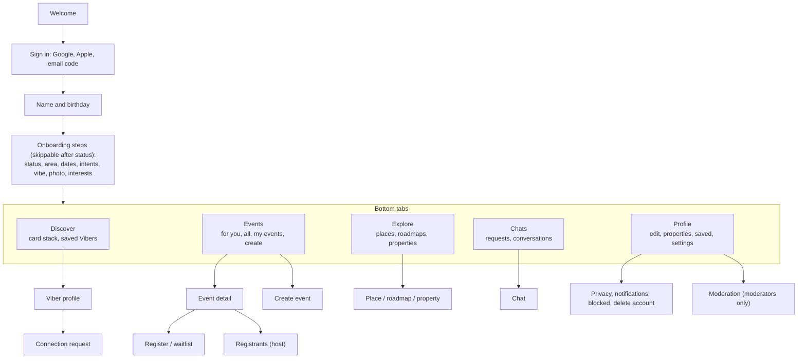

# Vibers Club — UI and UX Specification (navigation and screen inventory)

- **Status:** Draft v0.1. Visual design (colours, type, components) comes from the design work in milestone M2; this file fixes navigation and the screen list so engineering can start.
- **Last updated:** 2026-10-25

## Navigation

## Screen inventory (MVP)

| Area | Screens |
| --- | --- |
| Entry | Welcome; Sign in; Email code; Name and birthday; Under-18 stop |
| Onboarding | Travel status; Area; Dates and flexibility; Intents; Vibe composer with suggested chips; Interest picker; Photo |
| Discover | Card stack; Card expanded (Viber profile); Mutual-like prompt; Connection request sheet; Saved Vibers; Empty state |
| Events | For you; All events with filters; Event detail; Register confirmation (paid: payment instructions and disclaimer); Waitlist state; Create event (details, time, place or property, capacity and price, interests confirm, preview); Edit event; Cancel event; My events (hosting, attending, past); Registrants; Send update; Rate event |
| Explore | Explore home; Places list with filters; Place detail; Roadmaps list; Roadmap detail; Property page |
| Chats | Requests inbox; Conversations list; Chat; Report message |
| Profile | My profile; Edit profile; Edit vibe and interests; Travel plan; My properties; Add or edit property; Saved; Notifications list |
| Settings | Privacy (discoverable, show dates, attendee lists, women-only); Notification preferences; Blocked users; Phone verification; Community rules; Delete account; Legal pages |
| Moderation | Queue; Report detail; User summary |

## UX rules

- **Two minutes to value.** Only travel status is mandatory; every other onboarding step shows "Skip".
- **Explain every match** in one line on the card.
- **Ask for push permission after a meaningful moment** (first like, first RSVP), not on first launch.
- **Safety in reach:** Block and Report in the overflow menu of every profile, chat, event, review and property.
- **Patchy networks:** show cached lists, queue chat sends, and show clear retry states.
- **Honest data:** places and roadmaps show "Curated by Vibers Club"; paid events show "Pay the host directly; Vibers Club does not handle payments or refunds".
- **Accessibility:** minimum 44 pt touch targets; text scales with system font size; colour is never the only signal.
